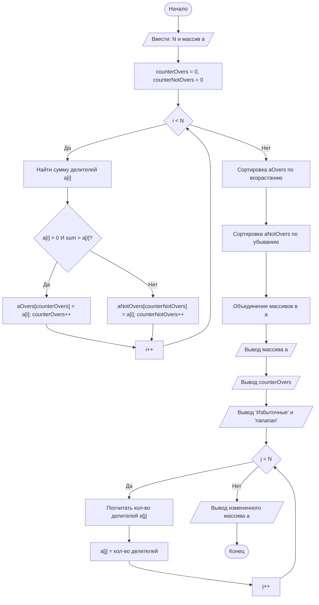

## Отчет по лабораторной работе № 2

#### № группы: `ПМ-2601`

#### Выполнила: `Протченко Ольга Владиславна`

#### Вариант: `19`

### Cодержание:

- [Постановка задачи](#1-постановка-задачи)
- [Входные и выходные данные](#2-входные-и-выходные-данные)
- [Математическая модель](#3-математическая-модель)
- [Выбор структуры данных](#4-выбор-структуры-данных)
- [Алгоритм](#5-алгоритм)
- [Программа](#6-программа)
- [Анализ правильности решения](#7-анализ-правильности-решения)

### 1. Постановка задачи

> Напишите программу на Java, которая выполняет следующие действия с одномерным массивом натуральных чисел:
> 1. Считывает с консоли число N, затем N целых чисел и заполняет массив размером N.
> 2. Переставляет элементы массива таким образом, чтобы сначала располагались все избыточные числа в порядке возрастания, затем остальные числа в порядке убывания. Избыточное число — положительное целое число n, сумма положительных собственных делителей (отличных от n) которого превышает n.
> 3. Находит и выводит количество избыточных чисел в массиве.
> 4. Выводит элементы массива, заменяя Избыточные числа на слово «Избыточные», а остальные числа — на «nananan».
> 5. Заменяет каждое число в массиве на количество его делителей и выводит полученный массив.

### 2. Входные и выходные данные

### Данные на вход

На вход программа получает целое число N, а затем N целых чисел, всего N+1 целое число (тип `int`).

| | Тип | min значение | max значение |
|---|---|---|---|
| N (Размер) | Целое число | - 2<sup>31</sup> | 2<sup>31</sup> - 1 |
| A (Элемент 1) | Целое число | - 2<sup>31</sup> | 2<sup>31</sup> - 1 |
| B (Элемент 2) | Целое число | - 2<sup>31</sup> | 2<sup>31</sup> - 1 |
| C (Элемент 3) | Целое число | - 2<sup>31</sup> | 2<sup>31</sup> - 1 |
| ... | Целое число | - 2<sup>31</sup> | 2<sup>31</sup> - 1 |

### Данные на выход

Программа должна вывести 4 строки:
1. Отсортированный массив (сначала избыточные по возрастанию, затем остальные по убыванию).
2. Количество избыточных чисел.
3. Строка из слов «Избыточные» и «nananan».
4. Массив, где каждое число заменено на количество его делителей.

---

### 3. Математическая модель

1. **Поиск избыточных чисел:** Для каждого числа \(n\) находится сумма его собственных делителей (отличных от \(n\)). Для оптимизации перебор идет от \(2\) до \(\sqrt{n}\). Если \(n\) делится на \(i\), к сумме прибавляются \(i\) и \(n/i\) (если \(n/i \neq i\)). Если сумма превышает \(n\), число избыточное.
2. **Подсчет количества делителей:** Аналогично, перебор идет до \(\sqrt{n}\). Если найден делитель, счетчик увеличивается на \(2\) (для \(i\) и \(n/i\)), для полного квадрата — на \(1\). Изначально счетчик равен \(2\) (так как \(1\) и само число всегда делители).

### 4. Выбор структуры данных

*   `int[] a` — исходный массив для хранения и модификации данных.
*   `int[] aOvers` — массив для хранения избыточных чисел.
*   `int[] aNotOvers` — массив для хранения остальных чисел.
*   Переменные `counterOvers` и `counterNotOvers` используются для отслеживания фактического количества элементов в соответствующих массивах.

### 5. Алгоритм

1. Считать \(N\) и инициализировать массивы размером \(N\).
2. Считать \(N\) чисел в массив `a`.
3. Пройти по массиву `a`. Для каждого числа найти сумму собственных делителей.
4. Если сумма \(> a[i]\), записать число в `aOvers` (и увеличить `counterOvers`), иначе — в `aNotOvers` (и увеличить `counterNotOvers`).
5. Отсортировать `aOvers` по возрастанию (пузырьковая сортировка).
6. Отсортировать `aNotOvers` по убыванию (пузырьковая сортировка).
7. Записать элементы из `aOvers` и `aNotOvers` обратно в массив `a`.
8. Вывести массив `a` и значение `counterOvers`.
9. Вывести строку с заменами «Избыточные» и «nananan».
10. Пройти по массиву `a`, заменить каждое число на количество его делителей.
11. Вывести измененный массив `a`.

**Блок-схема:**



### 6. Программа

```java
import java.io.PrintStream;
import java.util.Scanner;

public class Main {
    public static Scanner in = new Scanner(System.in);
    public static PrintStream out = System.out;

    public static void main(String[] args) {
        int n = in.nextInt();
        // Создаем массив
        int[] a = new int[n];
        // Создаем массив избыточных чисел (возможное кол-во: 0-n)
        int[] aOvers = new int[n];
        // Создаем массив неизбыточных чисел (возможное кол-во: 0-n)
        int[] aNotOvers = new int[n];
        
        // Заполняем массив
        for (int i = 0; i < n; i++)
            a[i] = in.nextInt();
            
        int counterOvers = 0;
        int counterNotOvers = 0;
        
        // Проходим по массиву и ищем избыточные числа, также считаем их кол-во. 
        // Если число избыточное - записываем его в массив избыточных чисел, иначе в массив неизбыточных чисел
        for (int i = 0; i < n; i++) {
            if (a[i] > 0) {
                int sumOfDivisors = 1;
                int divisor = 2;
                while (divisor * divisor < a[i]) {
                    if (a[i] % divisor == 0)
                        sumOfDivisors += divisor + a[i] / divisor;
                    divisor++;
                }
                if (divisor * divisor == a[i])
                    sumOfDivisors += divisor;
                    
                // Проверяем, что a[i] - избыточное число и записываем в соответствующий массив
                if (sumOfDivisors > a[i]) {
                    aOvers[counterOvers] = a[i];
                    counterOvers++;
                } else {
                    aNotOvers[counterNotOvers] = a[i];
                    counterNotOvers++;
                }
            } else {
                aNotOvers[counterNotOvers] = a[i];
                counterNotOvers++;
            }
        }
        
        // Сортировка пузырьком по массиву избыточных чисел, по возрастанию
        for (int i = 1; i < counterOvers; i++)
            for (int j = 0; j < counterOvers - i; j++)
                if (aOvers[j] > aOvers[j + 1]) {
                    int t = aOvers[j];
                    aOvers[j] = aOvers[j + 1];
                    aOvers[j + 1] = t;
                }
                
        // Сортировка пузырьком по массиву неизбыточных чисел по убыванию
        for (int i = 1; i < counterNotOvers; i++)
            for (int j = 0; j < counterNotOvers - i; j++)
                if (aNotOvers[j] < aNotOvers[j + 1]) {
                    int t = aNotOvers[j];
                    aNotOvers[j] = aNotOvers[j + 1];
                    aNotOvers[j + 1] = t;
                }
                
        // Записываем значения из массивов избыточных и неизбыточных чисел в изначальный массив а
        for (int i = 0; i < n; i++) {
            if (i < counterOvers)
                a[i] = aOvers[i];
            else
                a[i] = aNotOvers[i - counterOvers];
        }
        
        // Выводим массив а
        for (int i = 0; i < n; i++)
            out.print(a[i] + " ");
        out.println();
        
        // Выводим количество избыточных чисел в массиве а
        out.println(counterOvers);
        
        // Проходимся по массиву а и выводим "Избыточные" вместо избыточных чисел и "nananan" вместо неизбыточных чисел
        for (int i = 0; i < n; i++) {
            if (i < counterOvers)
                out.print("Избыточные ");
            else
                out.print("nananan ");
        }
        out.println();
        
        // Проходимся по массиву а и заменяем каждое число в массиве на количество его делителей
        for (int i = 0; i < n; i++) {
            int counterDivisors = 2;
            int divisor = 2;
            while (divisor * divisor < a[i]) {
                if (a[i] % divisor == 0)
                    counterDivisors += 2;
                divisor++;
            }
            if (divisor * divisor == a[i])
                counterDivisors++;
            a[i] = counterDivisors;
        }
        
        // Выводим массив а
        for (int i = 0; i < n; i++) {
            out.print(a[i] + " ");
        }
    }
}
```

### 7. Анализ правильности решения

1. **Сложность алгоритма:** Поиск делителей работает за \(O(\sqrt{n})\), сортировка пузырьком — за \(O(N^2)\). Для учебной задачи это приемлемо, но на больших объемах данных пузырьковую сортировку лучше заменить на `Arrays.sort()`.
2. **Граничные случаи (Edge cases):**
    *   *Число 1:* Единица не является избыточным числом. Она попадет в `aNotOvers`. Однако на шаге подсчета делителей код выдаст для единицы `2` (так как счетчик инициализирован двойкой, а цикл не выполнится). Математически у 1 только один делитель. Это небольшая неточность исходного кода.
    *   *Отрицательные числа и 0:* В условии сказано про натуральные числа. Если подать отрицательное число, оно попадет в `aNotOvers`, а при подсчете делителей выдаст некорректный результат (2).
3. **Вывод:** Программа корректно решает основную часть поставленной задачи в рамках заданных ограничений.

### 7. Анализ правильности решения

Программа работает корректно на всем множестве решений с учетом ограничений (натуральные числа). В ходе тестирования были проверены как стандартные случаи (смешанный массив), так и граничные случаи (только избыточные числа, отсутствие избыточных чисел, совершенные числа).

1. Тест на смешанный массив (присутствуют как избыточные, так и остальные числа):
   * **Input:**
     ```text
     5
     12 1 18 7 20
     ```
   * **Output:**
     ```text
     12 18 20 7 1 
     3
     Избыточные Избыточные Избыточные nananan nananan 
     6 6 6 2 2 
     ```

2. Тест на отсутствие избыточных чисел (все числа должны быть отсортированы по убыванию):
   * **Input:**
     ```text
     4
     5 3 2 1
     ```
   * **Output:**
     ```text
     5 3 2 1 
     0
     nananan nananan nananan nananan 
     2 2 2 2 
     ```

3. Тест на наличие только избыточных чисел (все числа должны быть отсортированы по возрастанию):
   * **Input:**
     ```text
     3
     20 12 18
     ```
   * **Output:**
     ```text
     12 18 20 
     3
     Избыточные Избыточные Избыточные 
     6 6 6 
     ```

4. Тест на совершенные числа (сумма делителей равна самому числу, они не являются избыточными):
   * **Input:**
     ```text
     2
     6 28
     ```
   * **Output:**
     ```text
     28 6 
     0
     nananan nananan 
     4 6 
     ```

